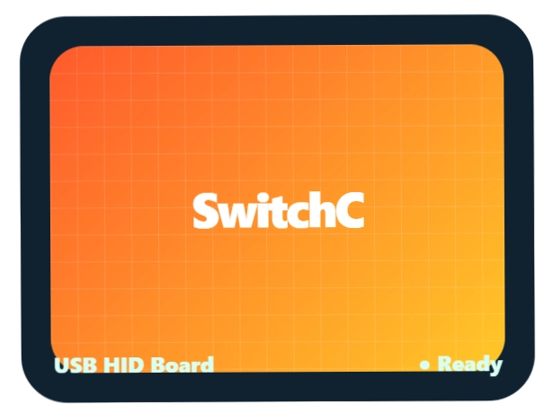
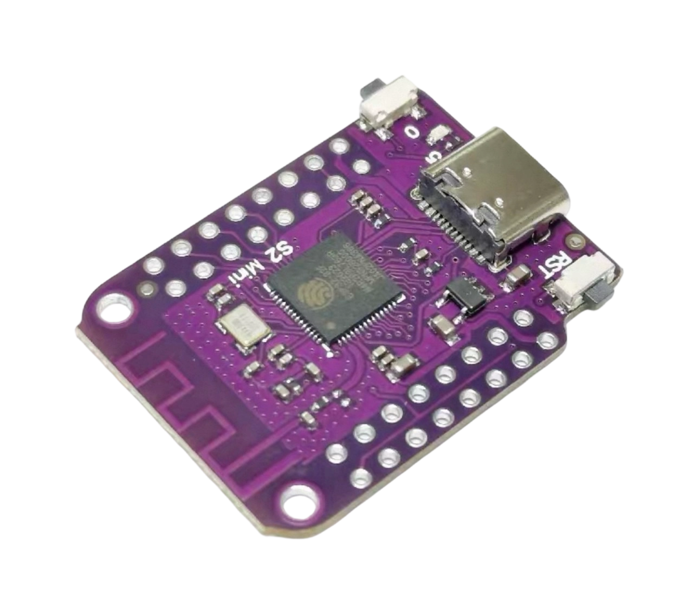

# トモダチコレクション わくわく生活

## 朋友收集梦想生活自动画图工具

### SwitchC 固件源码

**成本仅需 10 元人民币（ESP32-S2 mini 主板）**

**无脑烧录，点击这里：[switchc.shop 烧录页](https://switchc.shop/flash.html)**

> 想折腾的人看下面源码自己改；不想折腾、小白直接点上面链接去网站免费烧录，插上板子就能用，不用装工具。
>
> 关键词：朋友收集 / 梦想生活 / 朋友收集梦想生活 / 自动画图 / 自动化绘图 / 自动工具 / Tomodachi / ESP32-S2 mini / SwitchC

仅支持 ESP32-S2 mini 一款主板，其他主板暂不支持。

目前支持的游戏：朋友收集梦想生活、喷喷 3（Splatoon 3）。

## 这是什么

SwitchC 是一块模拟 Switch Pro 手柄的自动绘画板子，插到 Switch 上，在《朋友收集梦想生活》里自动画图。
板子自带网页后台：上传图片、调画布、生成绘图路径、开始 / 暂停 / 保存，画完不用手动一笔一笔描。

## 功能

- 模拟 Pro 手柄有线连接
- 分类模板：不同区域的画布尺寸、遮罩、可绘区域不同
- 图片录入：上传图片、抠图、去背景、减少杂色
- 画布调整：缩放、上下左右移动、预览
- 画笔大小：1x1 / 3x3 / 5x5，需与游戏内画笔大小一致
- 绘图方案与精度、速度选择
- 高级颜色设置：颜色识别、实机校准、相似色处理
- 任务管理：生成路径、上传任务、实时进度、异常提示
- 安全暂停、保存数据、原点继续
- 分享码：生成、导入、投稿
- 支持游戏：朋友收集梦想生活、喷喷 3
- 联网 / 离线模式、切换 WiFi、在线更新

## 快速开始

小白直接走网站免费烧录，不用装任何工具：

1. 用支持传数据的数据线，把 ESP32-S2 mini 连到电脑
2. 点上面 **[无脑烧录，点击这里](https://switchc.shop/flash.html)**
3. 按住 0/BOOT，点一下 RST，不要松开 0/BOOT，再点“连接主板”，选 ESP32-S2 串口
4. 点免费烧录，开始烧录后再松开 0/BOOT，烧完再拔线

想折腾的人：源码在 firmware/ 目录，烧录命令见 flash/ 目录，也可以用 esptool.py 离线烧录。

## 使用流程

1. 硬件准备：ESP32-S2 mini + 可传数据的数据线
2. 烧录固件：见上
3. Switch 设置：打开“Pro 手柄的有线连接”
4. 板子联网：手机连 SwitchC-wifi配置 配网，再连 SwitchC 热点（密码 12345678），浏览器打开 192.168.4.1
5. 上传图片、调画布、确认预览、确认画笔大小
6. 开始绘图：不要碰手柄、不要让 Switch 休眠、不要拔线；要停先用安全暂停或保存数据

完整教程见 docs/ 目录。

## 目录结构

- docs/：完整使用教程、图片录入、画布调整、分享码、常见问题
- firmware/：固件源码 SwitchC_S2_v0.2.0.ino 及 0.2.0 固件说明
- LICENSE：GPLv3
- flash/：网站烧录说明 + esptool.py 离线烧录命令
- hardware/：仅 ESP32-S2 mini 说明

## 许可证

本项目采用 GPLv3 许可证（见 LICENSE 文件）：别人可以自由使用、修改、分发，但改了再发布必须同样以 GPLv3 开源，不能改完闭源卖钱。
