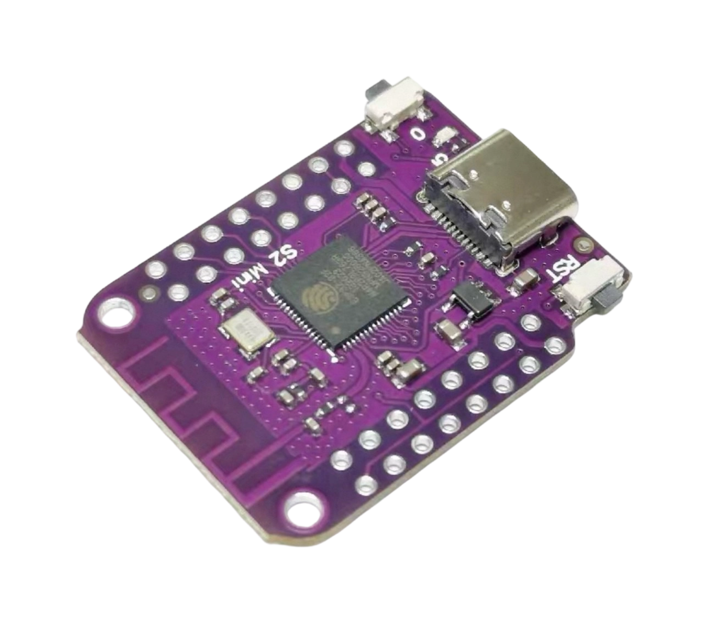
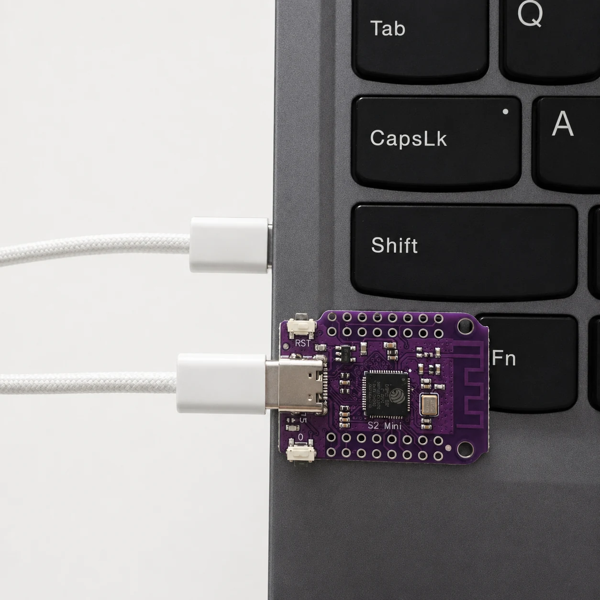
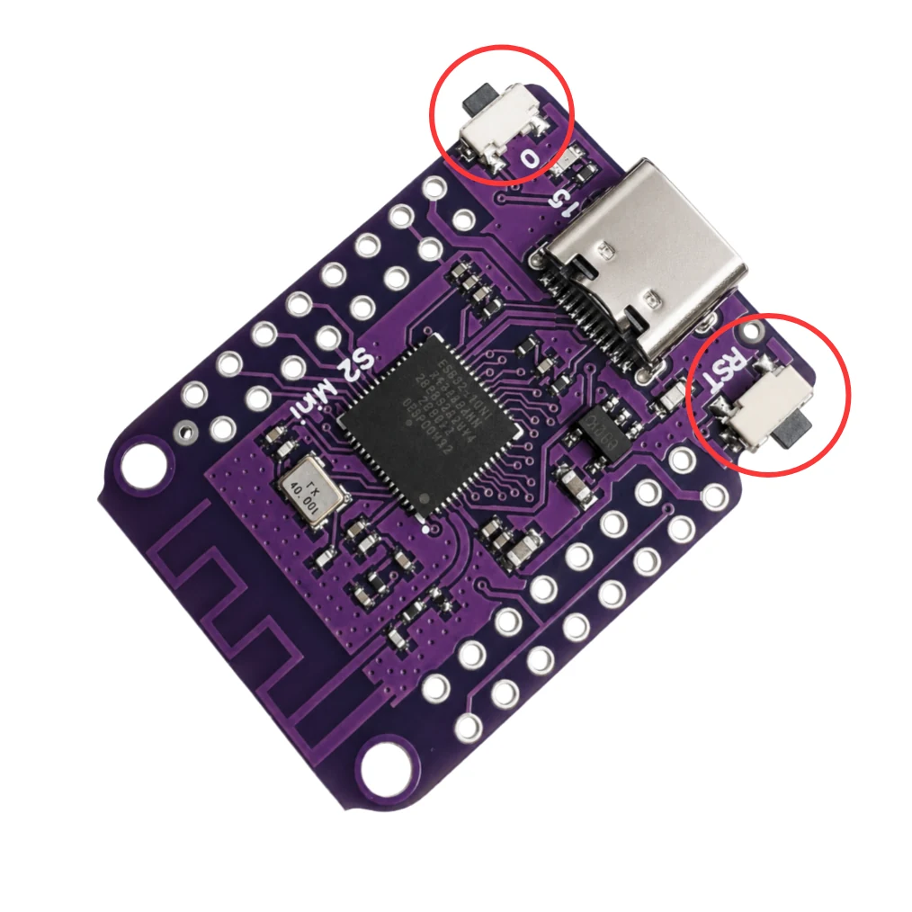
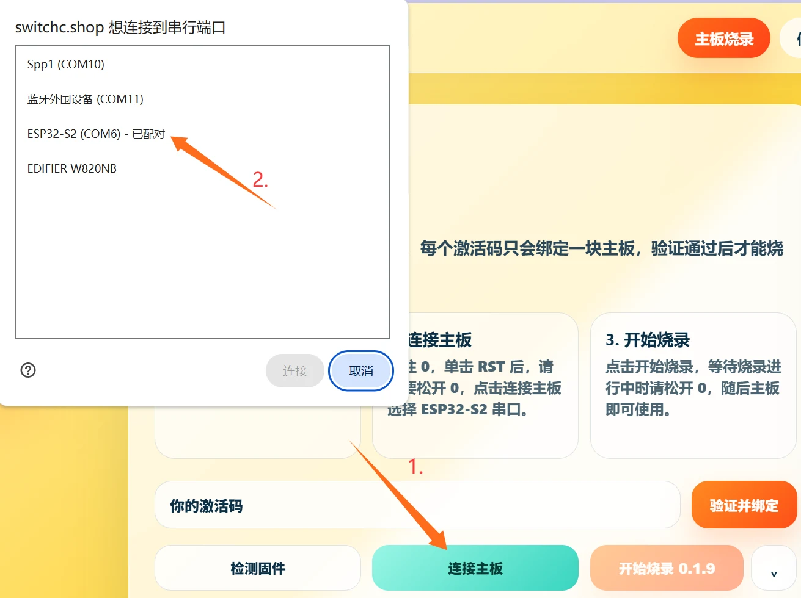
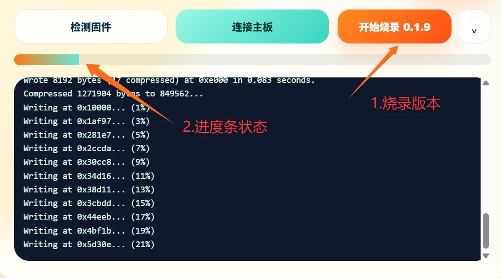
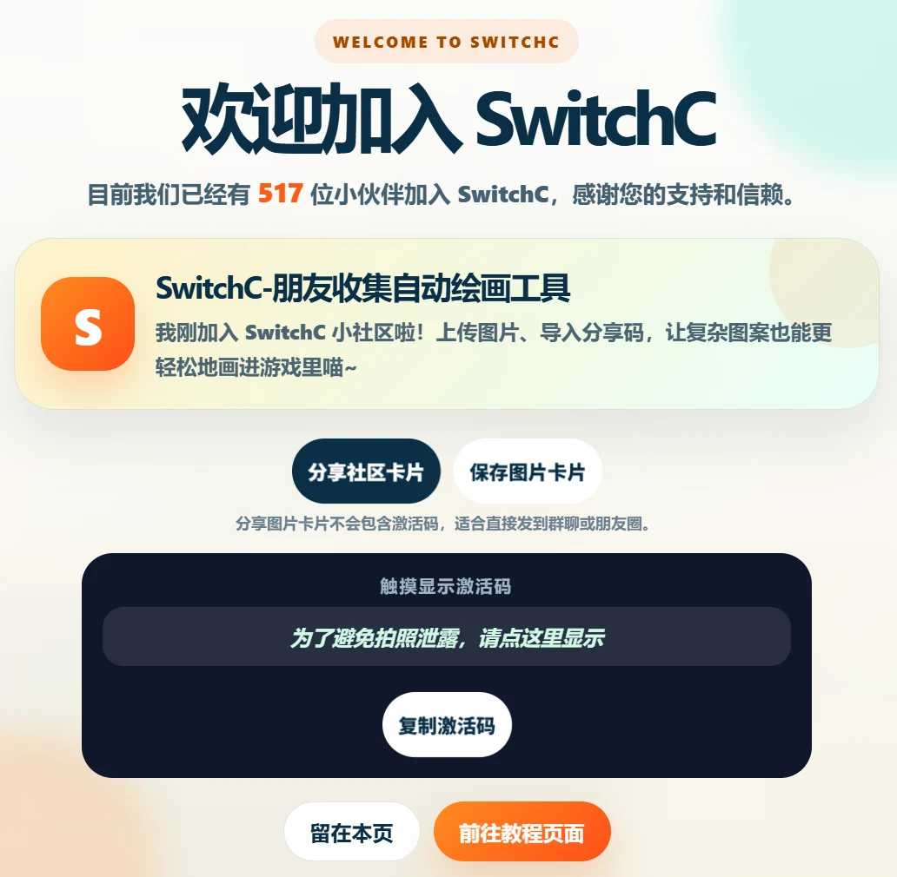

# 01 硬件准备与烧录

仅支持 ESP32-S2 mini，其他主板暂不支持。

## 硬件准备

开始前确认主板带 PSRAM，并准备一根能够传输数据的双 Type-C 线。只有充电功能的数据线无法烧录或控制 Switch。

- 主板：ESP32-S2 mini，高配带 PSRAM 更稳，主板上的 0/BOOT 与 RST 按钮会在烧录时使用
- 数据线：必须支持文件传输，只充电的线烧不上去，优先用质量稳定的短线
- Switch 主机与电源：绘图前确认主机不要休眠，电量足够

## 烧录（首选：网站免费烧录）

1. 用可传数据的数据线，把 S2 mini 连到电脑
2. 打开 https://switchc.shop/ ，点“主板烧录”，或直接点 README 顶部的无脑烧录链接
3. 按住 0/BOOT，点一下 RST，不要松开 0/BOOT，再点“连接主板”，选 ESP32-S2 串口

4. 点免费烧录，开始烧录后再松开 0/BOOT，烧完再拔线

5. 烧录中不要拔线、刷新网页、切换设备

## 烧录（进阶：esptool.py）

见 flash/ 目录。固件 0.2.0 地址表：
- bootloader.bin -> 0x1000
- partitions.bin -> 0x8000
- boot_app0.bin -> 0xE000
- switchc_app.bin -> 0x10000
- Flash 大小 4MB，模式 dio，频率 40m
