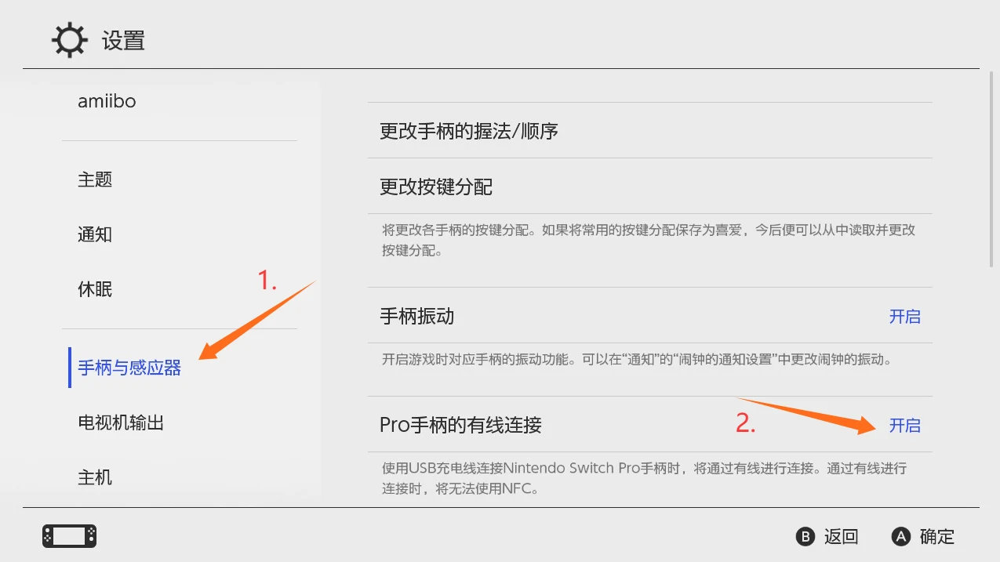
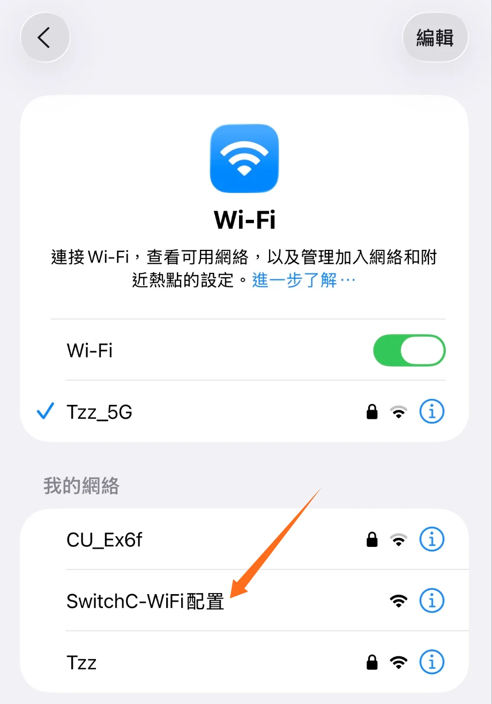
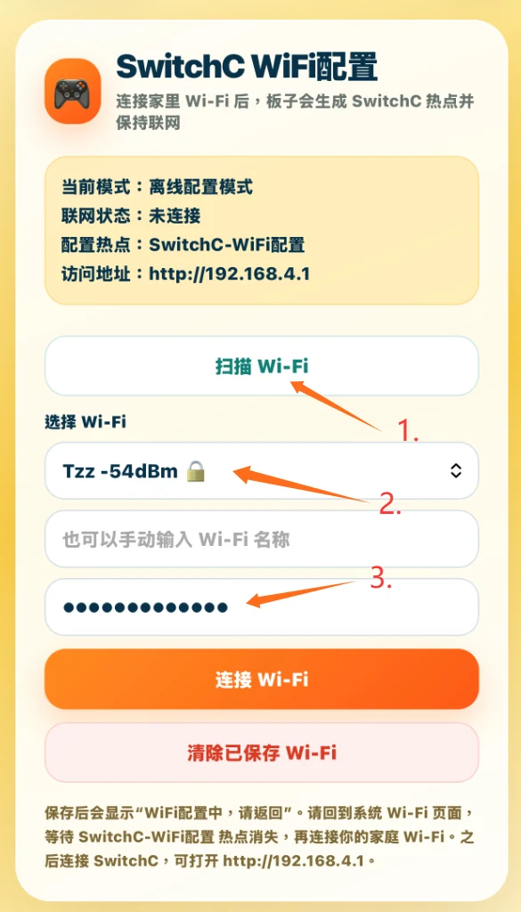
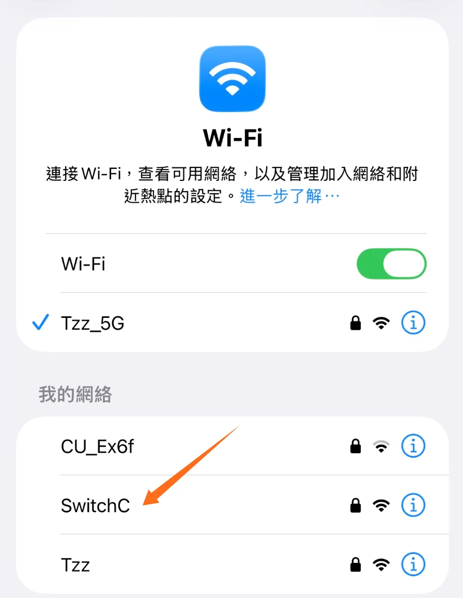
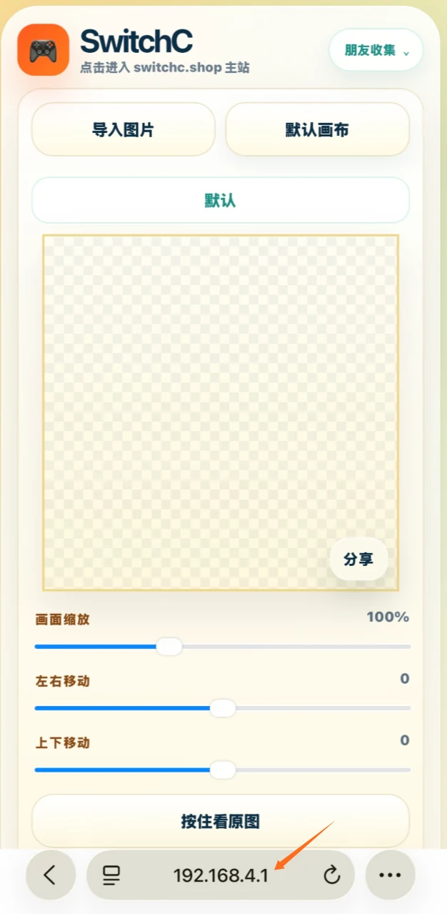
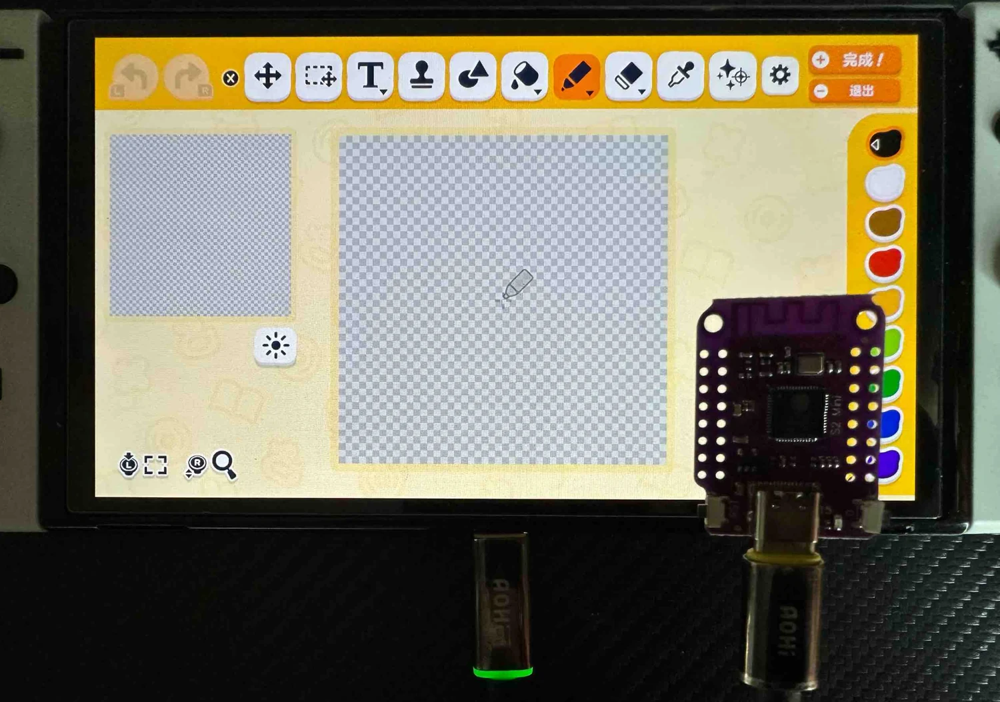

# 02 Switch 设置与联网

## Switch 主机设置

1. Switch 主界面点下方齿轮，进入“设置”
2. 进入“手柄与感应器”
3. 打开“Pro 手柄的有线连接”，必须打开，否则板子插上去不会被识别成手柄

## 板子联网

1. 手机连配置热点：SwitchC-wifi配置，连接后自动跳转 WiFi 配置界面
2. 选最常用、最固定的 WiFi

3. 配置完成后回 WiFi 列表，稍等会出现 SwitchC 热点，密码 12345678

4. 连 SwitchC 热点后，浏览器打开 192.168.4.1，进入板子后台

5. 手机提示“无互联网”是正常的，这个热点只是用来进后台
6. 换 WiFi：在板子网页左上角手柄图标里进网络设置，重新配置
